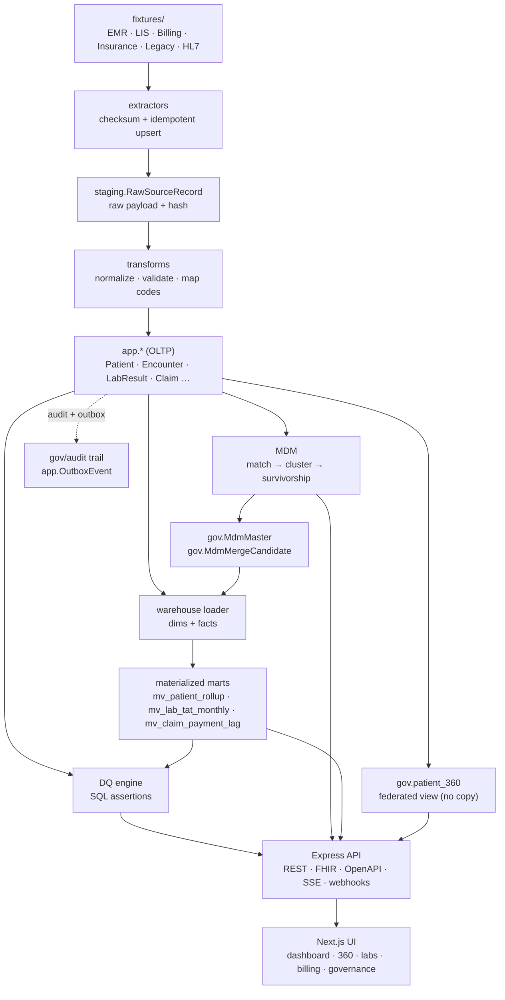

# How MediData works

A guided tour of the platform: what each process does, how a source record becomes a
governed golden record, which business rules run, and how to demo all of it.

> Everything in this project is **synthetic**. No real PHI. See the disclaimer in the README.

---

## 1. The one-paragraph version

MediData ingests five fake source systems (EMR, LIS, billing, insurance, legacy CSV) plus
HL7 v2 messages. Batch extracts land in a `staging` schema with a checksum, then transform
into a normalized **OLTP schema (`app`)**; HL7 messages are mapped directly onto the same
canonical tables. The platform then runs **master data management** to group duplicate
patients into golden records, loads a **dimensional warehouse (`warehouse`)** with
materialized marts, and continuously measures **data quality**, **freshness SLAs**, and
**lineage** in a governance schema (`gov`). A REST/FHIR API and a Next.js UI sit on top.

---

## 2. Architecture at a glance



### Two runtimes, one database

| Process    | Command                                | Responsibility                                                                                                |
| ---------- | -------------------------------------- | ------------------------------------------------------------------------------------------------------------- |
| **API**    | `backend → npm run dev` (or `dev:api`) | Express on `:4000`. Auth, REST, FHIR, HL7, webhooks, SSE, OpenAPI. Read-mostly; writes go to `app` and `gov`. |
| **Worker** | same command (or `dev:worker`)         | `node-cron` schedules: ETL+MDM+warehouse+DQ every 15 min, freshness every 5 min, outbox every 1 min.          |
| **Web**    | `frontend → npm run dev`               | Next.js 15 App Router on `:3000`. Talks to `:4000` using `NEXT_PUBLIC_API_URL`.                               |

The root `scripts/dev.mjs` just starts these child processes with prefixed logs. There is no
queue or broker required — Redis is optional; cron runs in-process.

---

## 3. Schema map

PostgreSQL, one database, four schemas. Model definitions live in
`backend/packages/db/prisma/schema.prisma`.

### `app` — operational (OLTP) truth

| Table                   | What it holds                                                              |
| ----------------------- | -------------------------------------------------------------------------- |
| `User`                  | Demo accounts, bcrypt hash, role, optional `patientId` link for the portal |
| `Patient`               | Demographics + normalized name/DOB used for matching                       |
| `Provider`, `Location`  | Clinical reference data                                                    |
| `Encounter`             | Visits (`INPATIENT`, `OUTPATIENT`, `EMERGENCY`, `TELEHEALTH`)              |
| `LabOrder`, `LabResult` | Orders → results, reference range, abnormal flag, release status           |
| `Payer`, `Claim`        | Insurance and revenue cycle                                                |
| `Consent`               | Portal consent flags                                                       |
| `AuditLog`              | Every mutating request (actor, role, action, subject, IP, request id)      |
| `OutboxEvent`           | Transactional outbox for downstream delivery                               |
| `DocumentControl`       | ISO 15189-style controlled documents                                       |

### `staging` — landing zone

| Table             | What it holds                                                                            |
| ----------------- | ---------------------------------------------------------------------------------------- |
| `RawSourceRecord` | One row per source record: connector, source key, payload JSON, checksum, load timestamp |

A unique key on `(sourceSystem, sourceKey)` makes extraction **idempotent**: re-running a
connector updates instead of duplicating.

### `warehouse` — analytics star schema

| Table                                                                               | Type                             |
| ----------------------------------------------------------------------------------- | -------------------------------- |
| `DimPatient`, `DimProvider`, `DimLocation`, `DimPayer`, `DimDate`, `DimTestCatalog` | Dimensions                       |
| `FactEncounter`, `FactLabResult`, `FactClaim`                                       | Facts (grain: one row per event) |

Plus three materialized marts built by `backend/packages/db/sql/warehouse_views.sql`:
`mv_patient_rollup`, `mv_lab_tat_monthly`, `mv_claim_payment_lag`.

### `gov` — governance

| Table                      | What it holds                                               |
| -------------------------- | ----------------------------------------------------------- |
| `DataCatalog`              | Table/column inventory, classification, owner               |
| `Glossary`                 | Business terms and definitions                              |
| `PipelineRun`              | Run ledger: connector, rows in/out, status, error, duration |
| `DqRule`, `DqResult`       | Rule definitions + append-only evaluation history           |
| `MdmMaster`                | Source patient → golden id mapping                          |
| `MdmMergeCandidate`        | Pairs in the human-review band                              |
| `FreshnessSla`, `AlertLog` | Per-table staleness limits and breach alerts                |

`app.DocumentControl` holds the ISO 15189-style policy documents referenced from the catalog
and glossary.

`gov.patient_360` is a **view**, not a copy: it joins `app` and `staging` so the UI can show
one federated patient timeline.

---

## 4. The pipeline, step by step

Run it once with `npm run pipeline` from the repo root (or on schedule via the worker).
Implementation: `backend/apps/worker/src/jobs.ts` → `runFullPipeline()`, one-shot report in
`run-pipeline.ts`, orchestration in `backend/packages/etl-core/src/pipeline.ts`.

### Step 1 — Seed (once)

`npm run seed` populates `app`, `gov`, and reference data with deterministic synthetic rows:
patients, providers, locations, encounters, labs, claims, catalog, glossary, DQ rules,
freshness SLAs, and users. It also plants a few **deliberate defects** (see §5) so the
governance screens have something to find.

### Step 2 — Extract

Five connectors read `backend/fixtures/` (`emr`, `lis`, `billing`, `insurance`, `legacy`).
HL7 v2 ADT/ORU arrive over HTTP and are parsed straight onto the canonical OLTP tables. Each
extracted batch row carries a source key and a checksum.

### Step 3 — Transform

`backend/packages/etl-core/src/transforms/` normalizes names, dates, sex codes, units, and
enum values, and rejects rows that cannot be repaired. Transform rules are unit-tested.

### Step 4 — Load staging

Every row is upserted into `staging.RawSourceRecord`. This is the replayable history: you can
re-process staging without re-reading sources.

### Step 5 — Project into OLTP

The loader writes `app.Patient`, `Encounter`, `LabResult`, `Claim`, etc. Deterministic keys
mean repeated runs converge instead of duplicating.

### Step 6 — MDM (golden records)

1. **Block** on normalized name and DOB to avoid comparing every pair.
2. **Score** pairs with weighted fuzzy similarity.
3. **Auto-merge** pairs ≥ `0.97`.
4. **Queue for review** pairs in `[0.85, 0.97)` in `gov.MdmMergeCandidate`.
5. **Survivorship** picks the best field values for the merged record:
   source priority `EMR > LIS > BILLING > INSURANCE > LEGACY`, then most complete record,
   then lowest MRN.
6. **Emit** `gov.MdmMaster` rows mapping every source patient to a golden id.

Golden ids are hashes of the sorted cluster members, so re-running produces the same ids.
Review decisions (approve/reject) are recorded and do not re-queue forever.

### Step 7 — Warehouse load

Dimensions and facts are upserted from `app` (and from transformed fixture rows). Totals are
read back from the database, so the UI never trusts in-memory counts. SQL assets are applied
idempotently by `applySqlAssets`, and materialized views are refreshed.

### Step 8 — Data quality

`backend/packages/dq/src/index.ts` executes each rule's SQL assertion and appends a
`gov.DqResult`. The scorecard is the source of truth for the dashboard score and the
`/api/governance/quality` endpoint.

### Step 9 — Freshness

For each `gov.FreshnessSla`, the worker compares the newest row timestamp with the allowed
staleness. Breaches create de-duplicated `gov.AlertLog` entries and appear on the Freshness
screen.

### Step 10 — Outbox

`app.OutboxEvent` rows created during writes are delivered by the minute-ly outbox job and
marked sent. Webhooks use HMAC signatures when `WEBHOOK_SECRET` is configured (otherwise the
JWT secret is the fallback).

---

## 5. Business rules worth knowing

### MDM thresholds and survivorship

| Score         | Action                                 |
| ------------- | -------------------------------------- |
| `< 0.85`      | Not a match — ignored                  |
| `0.85 – 0.97` | Human review (`gov.MdmMergeCandidate`) |
| `≥ 0.97`      | Auto-merge into one golden record      |

Survivorship order: **source precedence → completeness → lowest MRN**.
Only `ADMIN` and `ANALYST` can approve/reject candidates; a `BILLER` gets `403`.

### Data-quality rules

The seeded rules and their intent:

| Code       | Rule                        | Severity | What it catches                          |
| ---------- | --------------------------- | -------- | ---------------------------------------- |
| `PAT-001`  | Unique MRN                  | CRITICAL | Duplicate medical record numbers         |
| `PAT-002`  | DOB not null                | CRITICAL | Missing date of birth                    |
| `PAT-003`  | Valid sex code              | WARNING  | Unknown sex enum value                   |
| `PAT-004`  | Duplicate patient detection | CRITICAL | Same normalized name + DOB               |
| `LAB-001`  | Result timestamp order      | CRITICAL | Resulted before collected (negative TAT) |
| `LAB-002`  | Value in range              | WARNING  | Abnormal flag outside `H/L/A`            |
| `LAB-003`  | Result has a value          | CRITICAL | Both numeric and text value null         |
| `BILL-001` | Amount non-negative         | CRITICAL | Negative billed/paid amounts             |
| `BILL-002` | Paid ≤ billed               | CRITICAL | Overpayment                              |
| `BILL-003` | Billing update SLA          | WARNING  | Open claim untouched beyond SLA          |
| `REF-001`  | Orphan foreign key          | CRITICAL | Claim without an encounter               |
| `REF-002`  | Code-set validity           | WARNING  | Encounter type outside the enum          |

On the seeded dataset you should see **failures** for `PAT-004` (the planted duplicates),
`LAB-001` (negative turnaround), and `BILL-003` (stale open claims). That is intentional —
a governance demo with a 100% green scorecard has nothing to show.

### ML risk model

`backend/packages/ml/src/index.ts` is a **fixed-weight logistic model** — no training, no
hidden state:

```
z = -2.2
  + 0.028·age
  + 1.40·abnormalResultRatio
  + 0.55·chronicDiagnoses
  + 0.45·emergencyVisits
  + 0.25·inpatientStays
  + 0.40·deniedClaims
  + 0.08·encounterCount
  + 0.12·avgInpatientLOS
p = sigmoid(z)     →  LOW < 0.34 · MEDIUM < 0.67 · HIGH ≥ 0.67
```

Before scoring, a **patient-scoped DQ gate** re-checks that patient's rows against the
critical invariants. If the patient's own data is broken, the API returns `409` instead of a
confident wrong prediction. The gate is deliberately scoped per patient so a few dirty demo
rows don't block everyone.

### Outcome KPIs

`/api/kpis/outcomes` and the Outcomes page contrast "before" and "after" the platform:

- **Duplicate rate** — same name + DOB rows vs. distinct golden ids.
- **Lab turnaround** — raw collected→resulted hours vs. the same measure with negative values
  clamped to zero.
- **Billing lag** — raw submitted→updated hours vs. capped at the 72-hour payer SLA.
- **DQ score** — latest persisted scorecard.

---

## 6. API contract

Every response is an envelope (`backend/apps/api/src/lib/envelope.ts`):

```jsonc
// success
{ "success": true, "data": { /* payload */ } }

// list payload
{ "success": true, "data": { "items": [], "page": 1, "pageSize": 500, "total": 123, "totalPages": 1 } }

// failure
{ "success": false, "error": { "code": "FORBIDDEN", "message": "…" } }
```

Auth: `POST /api/auth/login` sets an **httpOnly cookie** and also returns a bearer token.
The UI stores the token and sends `Authorization: Bearer …`; the cookie keeps server-side
requests working. `GET /api/auth/me` restores a session on reload (a `401` before login is
normal).

Roles: `ADMIN`, `PHYSICIAN`, `LAB_TECH`, `BILLER`, `ANALYST`, `AUDITOR`, `PATIENT`.
Authorization is CASL-based (`backend/apps/api/src/middleware/rbac.ts`); the UI mirrors the
same rules in `frontend/lib/ability.ts` to hide links it would only 403 on.

| Group      | Endpoints                                                                                                                                                   |
| ---------- | ----------------------------------------------------------------------------------------------------------------------------------------------------------- |
| Auth       | `POST /api/auth/login`, `POST /api/auth/logout`, `GET /api/auth/me`                                                                                         |
| Clinical   | `GET /api/patients`, `GET /api/patients/:id` (360), `GET /api/encounters`                                                                                   |
| Labs       | `GET /api/labs/orders`, `POST /api/labs/orders`, `GET /api/labs/results`, `POST /api/labs/results/:id/review`, `POST /api/labs/results/:id/release`         |
| Revenue    | `GET /api/billing/claims`, `GET /api/billing/invoices`, `GET /api/insurance/policies`, `GET /api/insurance/eligibility/:patientId`                          |
| Portal     | `GET /api/portal/records`, `GET /api/portal/results/:id/download`, `GET/POST /api/portal/consent`                                                           |
| Governance | `/api/governance/catalog`, `/glossary`, `/lineage`, `/quality`, `/freshness`, `/audit`, `/mdm/candidates`, `POST /api/governance/mdm/candidates/:id/review` |
| Analytics  | `GET /api/kpis/outcomes` (the dashboard composes this with quality/freshness + list totals)                                                                 |
| ML         | `GET /api/ml/risk/:patientId`                                                                                                                               |
| Admin      | `GET/POST /api/admin/users`                                                                                                                                 |
| Streaming  | `GET /api/stream/events` (SSE, powers the live feed)                                                                                                        |
| Interop    | `GET /fhir/Patient`, `/fhir/Encounter`, `/fhir/Observation`, `/fhir/Claim`, `POST /integrations/hl7/adt`, `POST /integrations/hl7/oru`                      |
| Ops        | `GET /health`, `GET /openapi.json`, `POST /webhooks/*` (HMAC)                                                                                               |

Middleware order matters: request context → security headers/CORS/cookies → rate limit →
**webhooks before JSON parsing** (raw-body HMAC) → JSON → auth attach → mutation audit →
routes → 404 → error handler.

---

## 7. Frontend map

`frontend/app/(dashboard)/layout.tsx` wraps every screen in `AuthGuard` + sidebar + top bar
with a live SSE feed. Navigation is filtered by role (`frontend/lib/nav.ts`).

| Page                       | Route                   | Reads                                                 |
| -------------------------- | ----------------------- | ----------------------------------------------------- |
| KPI Overview               | `/`                     | dashboard KPIs, quality score, freshness, MDM signals |
| Patients                   | `/patients`             | paged patients                                        |
| Patient 360                | `/patients/[id]`        | demographics, encounters, labs, claims, audit, risk   |
| Laboratory                 | `/labs`                 | orders/results, review and release actions            |
| Billing                    | `/billing`              | claims + invoices                                     |
| Insurance                  | `/insurance`            | policies + eligibility                                |
| Analytics                  | `/analytics`            | before/after KPI charts                               |
| Outcomes                   | `/outcomes`             | `OutcomeKpis`                                         |
| Governance → Catalog       | `/governance/catalog`   | `gov.DataCatalog`                                     |
| Governance → Glossary      | `/governance/glossary`  | `gov.Glossary`                                        |
| Governance → Lineage       | `/governance/lineage`   | source → staging → app → warehouse → consumption      |
| Governance → Data Quality  | `/governance/quality`   | rule scorecard + failing samples                      |
| Governance → Freshness SLA | `/governance/freshness` | SLA status + alerts                                   |
| Governance → MDM Review    | `/governance/mdm`       | candidate queue, approve/reject                       |
| Governance → Audit Trail   | `/governance/audit`     | `app.AuditLog`                                        |
| Portal → My Records        | `/portal`               | own record, results download, consent                 |
| Admin → Users              | `/admin/users`          | create users, assign roles                            |

Data fetching is TanStack Query via `frontend/lib/queries.ts` (`useApiQuery`, `useApiList`),
which unwraps the envelope, types `ApiError`, and retries/refreshes with sane defaults.
Login is autofill-safe: the form reads the submitted DOM values, not just React state.

---

## 8. Demo walkthrough (about 10 minutes)

Start both sides first:

```powershell
# Terminal 1
cd backend;  npm run dev
# Terminal 2
cd frontend; npm run dev
```

Then open <http://localhost:3000> and sign in as `admin@medidata.local` / `Passw0rd!123`
(click the ADMIN row in the demo table to fill it exactly).

1. **KPI Overview (`/`)** — quality score, freshness, volumes, MDM/review counts, live feed.
   Point out that the score is below 100 _by design_.
2. **Patients → pick a patient (360)** — one screen joins demographics, encounters, labs,
   claims, audit history, and the ML risk score. This is `gov.patient_360` plus API
   composition, not a copied table.
3. **Laboratory** — results with reference ranges and abnormal flags. As ADMIN or LAB_TECH,
   review and release a result; then check **Audit Trail** for the entry.
4. **Billing** — claims and invoices, including the stale open claims that drive `BILL-003`.
5. **Analytics / Outcomes** — the before/after story: duplicate rate drops after MDM, lab TAT
   improves once negative values are clamped, billing lag is capped at the payer SLA.
6. **Governance → Data Quality** — 12 rules; `PAT-004`, `LAB-001`, `BILL-003` fail with sample
   keys. This is expected, not a bug.
7. **Governance → MDM Review** — two candidates sit in the 0.85–0.97 band. Approve one and
   watch the golden-record count change; reject one to keep the queue honest. Try the same
   action as `biller@medidata.local` to see the `403`.
8. **Governance → Freshness SLA** — `staging` (30 min), `app.patients` (60 min), and
   `warehouse.fact_claim` (24 h) with pass/breach state.
9. **Governance → Lineage** — follow a field from fixture → staging → OLTP → warehouse → API.
10. **Portal** — log out, sign in as `patient@medidata.local`, and see only your own record
    (the API scopes it via `User.patientId`).

Optional API tour:

```powershell
curl.exe http://127.0.0.1:4000/health
curl.exe http://127.0.0.1:4000/openapi.json
curl.exe http://127.0.0.1:4000/fhir/Patient
```

---

## 9. Is the project finished?

**Functionally, yes.** The full path is implemented and verified:

- 5 connectors + HL7 ADT/ORU, staging, transforms, OLTP projection
- MDM with auto-merge, review queue, survivorship, idempotent golden ids
- Star-schema warehouse, 3 materialized marts, federated `patient_360`
- 12 DQ rules, freshness SLAs, audit trail, outbox
- Analytics KPIs and DQ-gated ML risk scores
- REST + FHIR + OpenAPI + SSE + HMAC webhooks
- Next.js UI with role-aware navigation for all screens
- 66 unit tests, 17 API smoke checks, clean typecheck, production build

Remaining caveats — all environmental, not missing features:

1. **Changes are uncommitted.** `git status` shows the whole implementation as modified/new.
   Commit before you hand it in or deploy it.
2. **`DIRECT_URL` currently points at Neon's pooled endpoint.** Migrations work, but Prisma
   recommends the unpooled host: drop `-pooler` from the hostname
   (`ep-…-pooler.c-3.…` → `ep-….c-3.…`) if `migrate deploy` ever times out.
3. **Redis / S3 / `WEBHOOK_SECRET` are optional** and fall back to in-process behavior. That is
   deliberate, so the demo runs on the free tier.
4. **Seeded defects are intentional.** A failing `PAT-004` / `LAB-001` / `BILL-003` is the
   governance story working.
5. **Synthetic data only.** No BAA exists for the free-tier database, so real PHI must never be
   loaded.

---

## 10. Troubleshooting

| Symptom                                        | Cause / fix                                                                                                             |
| ---------------------------------------------- | ----------------------------------------------------------------------------------------------------------------------- |
| Login returns `401`                            | Type the password exactly: capital `P`, digit `0`, ends `!123`. Or click the ADMIN demo row.                            |
| `process is not defined` in the browser        | The pino logger must stay server-only. Import it from `@medidata/shared/logger`, never the shared barrel.               |
| Frontend loads but data is empty               | API not running, or `frontend/.env.local` missing `NEXT_PUBLIC_API_URL=http://localhost:4000`.                          |
| `port already in use`                          | An old dev server is alive: `Get-NetTCPConnection -State Listen -LocalPort 3000,4000` then `taskkill /PID <pid> /T /F`. |
| Dashboard shows 0% quality                     | Pipeline has not run: `npm run pipeline` (2–5 min on Neon).                                                             |
| MDM review queue is empty                      | Candidates were already actioned. Re-run `npm run pipeline` to regenerate comparisons; decisions are preserved.         |
| `curl` to `localhost` returns `000` in scripts | Use `127.0.0.1` in automated probes.                                                                                    |

---

## 11. Where to read the code

| Concern                   | File                                                          |
| ------------------------- | ------------------------------------------------------------- |
| Data model                | `backend/packages/db/prisma/schema.prisma`                    |
| Seed + defects            | `backend/packages/db/src/seed.ts`                             |
| Pipeline orchestration    | `backend/packages/etl-core/src/pipeline.ts`                   |
| Connectors                | `backend/packages/etl-core/src/extractors/`                   |
| Warehouse loader          | `backend/packages/etl-core/src/warehouse-loader.ts`           |
| SQL marts + `patient_360` | `backend/packages/db/sql/warehouse_views.sql`                 |
| MDM rules                 | `backend/packages/mdm/src/index.ts`                           |
| DQ engine                 | `backend/packages/dq/src/index.ts`                            |
| Risk model + gate         | `backend/packages/ml/src/index.ts`                            |
| KPIs                      | `backend/packages/analytics/src/index.ts`                     |
| Scheduled jobs            | `backend/apps/worker/src/jobs.ts`, `apps/worker/src/index.ts` |
| API assembly              | `backend/apps/api/src/app.ts`                                 |
| RBAC                      | `backend/apps/api/src/middleware/rbac.ts`                     |
| Endpoint contract         | `backend/packages/shared/src/constants.ts`                    |
| UI navigation             | `frontend/lib/nav.ts`                                         |
| Data fetching             | `frontend/lib/queries.ts`                                     |
