# Project scope — Healthcare / Labs

The activity assigns each group **one industry** and asks for a flow:
**sources → integration methods → governance → outputs**. MediData is the
**Healthcare / Labs** column, implemented end to end. No other industry exists in the
codebase.

## Flow chart for the presentation

```mermaid
flowchart LR
    subgraph SRC["Data sources"]
        EMR["EMR<br/>patients + encounters"]
        LIS["LIS<br/>lab orders + results"]
        BIL["Billing<br/>claims + invoices"]
        INS["Insurance<br/>payers + coverage"]
    end

    subgraph INT["Integration methods"]
        ETL["ETL / ELT<br/>staging → transform → warehouse"]
        API["APIs<br/>REST · FHIR · HL7 v2"]
        FEED["Outbox change feed<br/>(SSE)"]
    end

    subgraph GOV["Governance needs"]
        HIPAA["HIPAA-aligned controls<br/>RBAC · audit · masking · consent"]
        ISO["ISO 15189<br/>authorized result release"]
    end

    subgraph OUT["Outputs"]
        P360["Patient 360<br/>one unified record"]
        RPT["Compliance views<br/>DQ · freshness · audit"]
    end

    SRC --> INT --> GOV --> OUT
```

> Governance is drawn as a stage for the activity, but in the platform it is
> **cross-cutting**: the same controls apply from ingestion through delivery.

## Coverage against the slide

| PPT item               | Status      | Evidence in this project                                                                          |
| ---------------------- | ----------- | ------------------------------------------------------------------------------------------------- |
| **EMR**                | Implemented | `backend/fixtures/emr/patients.json`; `emr` connector; `SourceSystem.EMR`; highest MDM priority   |
| **LIS**                | Implemented | `backend/fixtures/lis/results.json`; `etl:lis` run; lab results + TAT KPIs                        |
| **Billing**            | Implemented | `backend/fixtures/billing/claims.csv`; claims, invoices, billing-lag KPI                          |
| **Insurance**          | Implemented | `backend/fixtures/insurance/policies.json`; payers, eligibility, claim linkage                    |
| **CDC**                | Partial     | Outbox-driven change feed (`/api/stream/events`, `app.OutboxEvent`), **not** log-based CDC        |
| **ETL / ELT**          | Implemented | `packages/etl-core/src/pipeline.ts` (ETL) + `elt.ts` / materialized marts (ELT)                   |
| **APIs**               | Implemented | REST, OpenAPI, FHIR (`Patient/Encounter/Observation/Claim`), HL7 ADT/ORU, webhooks                |
| **HIPAA**              | Partial     | Aligned controls: RBAC, audit log, role-based masking, consent. The standard is not named in code |
| **ISO 15189**          | Implemented | Authorized result release, `DocumentControl` (`QMS-001`, `GOV-003`), audit on release             |
| **Patient 360**        | Implemented | `gov.patient_360` view → `/api/patients/:id` → `/patients/[id]` screen                            |
| **Compliance Reports** | Partial     | Live DQ scorecard, freshness SLA, audit trail screens — **no** PDF/CSV export                     |

Status legend: **Implemented** = working feature with code + data; **Partial** = the concept is
present but narrower than the label suggests.

## Presentation script

> “Our group was assigned **Healthcare / Labs**. Our sources are the **EMR, LIS, billing, and
> insurance** systems. We integrate them with **ETL/ELT** into a staging schema, transform and
> validate, then load an OLTP store and a dimensional warehouse; **REST, FHIR, and HL7 APIs**
> expose the data. Governance covers **HIPAA** through role-based access, audit logging,
> masking, and consent, plus **ISO 15189** controls such as authorized lab-result release.
> The outputs are **Patient 360** — one unified patient record — and **compliance views** for
> data quality, freshness, and audit.”

## Known gaps to acknowledge if asked

| Gap                | Why it exists                                                               | How to phrase it                                            |
| ------------------ | --------------------------------------------------------------------------- | ----------------------------------------------------------- |
| CDC                | Change events come from the transactional outbox, not database log capture. | “We use an outbox-based change feed rather than true CDC.”  |
| HIPAA              | The control is implemented through safeguards; the code names ISO 15189.    | “HIPAA-aligned controls: RBAC, audit, masking, consent.”    |
| Compliance reports | Governance is delivered as live dashboards, not exported documents.         | “Compliance dashboards rather than generated report files.” |

## Intentionally out of scope

| Item             | Reason                                                                |
| ---------------- | --------------------------------------------------------------------- |
| Other industries | The activity assigns one industry; this project is Healthcare / Labs. |
| Real PHI         | All data is synthetic; the free-tier database has no BAA.             |
