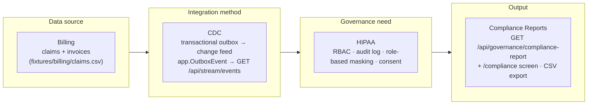

# Project scope — Healthcare / Billing

The activity assigns each group **one industry** and asks for a flow:
**sources → integration methods → governance → outputs**. MediData is the
**Healthcare** column, implemented end to end. No other industry exists in the
codebase.

## What we chose from the activity slide

| Slide item           | Our choice                         |
| -------------------- | ---------------------------------- |
| **Industry**         | Healthcare                         |
| **Data source**      | Billing only (claims + invoices)   |
| **Integration**      | CDC (change data capture)          |
| **Governance need**  | HIPAA                              |
| **Output**           | Compliance Reports                 |

## Flow chart for the presentation

> Governance is drawn as a stage for the activity, but in the platform it is
> **cross-cutting**: the same controls (RBAC, audit, masking, consent) apply from
> ingestion through delivery.

## How each choice is implemented

| Slide item               | Where it lives                                                                                                                                                        |
| ------------------------ | --------------------------------------------------------------------------------------------------------------------------------------------------------------------- |
| **Billing source**       | `backend/fixtures/billing/claims.csv`; `packages/etl-core/src/extractors/billing.ts`; `app.Claim` / `app.Invoice`; `GET /api/claims`; `/billing` screen              |
| **CDC integration**      | `app.OutboxEvent` written on every billing write; `GET /api/stream/events` (SSE); CDC counts surface in the compliance report (`pendingEvents` / `deliveredEvents`)     |
| **HIPAA governance**     | `middleware/rbac.ts` (role → subject → action), `app.AuditLog` + `/governance/audit`, `packages/shared` masking helpers, `app.Consent`                                |
| **Compliance Reports**   | `complianceReport()` in `apps/api/src/modules/governance/service.ts`; `GET /api/governance/compliance-report` (JSON or `?format=csv`); `/compliance` page + CSV button |

The scope is switched by `SCOPE_PROFILE` in `backend/packages/shared/src/constants.ts`
(default `billing` on the `scope/billing-cdc` branch, `full` on `main`). On the
billing profile the worker extracts **only** the billing connector
(`ACTIVE_CONNECTOR_NAMES`), the dashboard shows a billing overview, and the nav
shows only Billing, Compliance Reports, the HIPAA evidence screens, and user
administration.

## Presentation script

> “Our group chose **Healthcare**. Our data source is the **Billing** system —
> claims and invoices. We integrate it with **CDC**: every billing write emits a
> change event to a transactional outbox, and consumers read the change feed
> instead of re-polling the source. Our governance need is **HIPAA**, covered by
> role-based access control, an audit log on every read and write, role-based
> masking of identifiers, and patient consent records. The output is a
> **Compliance Report** — one payload that combines billing volumes, data-quality
> results, freshness against SLAs, audit activity, and CDC queue state, available
> as JSON or CSV from the Compliance Reports screen.”

## Known gaps to acknowledge if asked

| Gap                       | Why it exists                                                                     | How to phrase it                                                        |
| ------------------------- | --------------------------------------------------------------------------------- | ----------------------------------------------------------------------- |
| CDC mechanism             | Change events come from the transactional outbox, not database log capture (WAL). | “We use an outbox-based change feed rather than log-based CDC.”          |
| HIPAA naming              | The safeguards are implemented; HIPAA itself is a regulation, not a library.      | “HIPAA-aligned safeguards: RBAC, audit, masking, consent.”               |
| Clinical records          | Only billing was chosen, so EMR/LIS data exists solely to satisfy claim FKs.       | “Clinical rows are minimal stubs needed to keep claims referentially valid.” |

## Intentionally out of scope

| Item                         | Reason                                                                   |
| ---------------------------- | ------------------------------------------------------------------------ |
| EMR, LIS, Insurance sources  | The activity row selects Billing only.                                    |
| Patient 360, Labs, MDM merge | Outputs depend on multi-source clinical data that this scope excludes.    |
| Analytics, ML risk, Outcomes | The chosen output is Compliance Reports.                                  |
| Other industries             | The activity assigns one industry; this project is Healthcare.            |
| Real PHI                     | All data is synthetic; the free-tier database has no BAA.                 |
